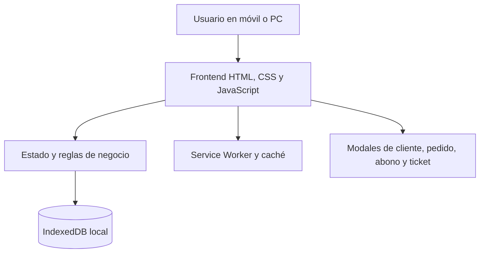
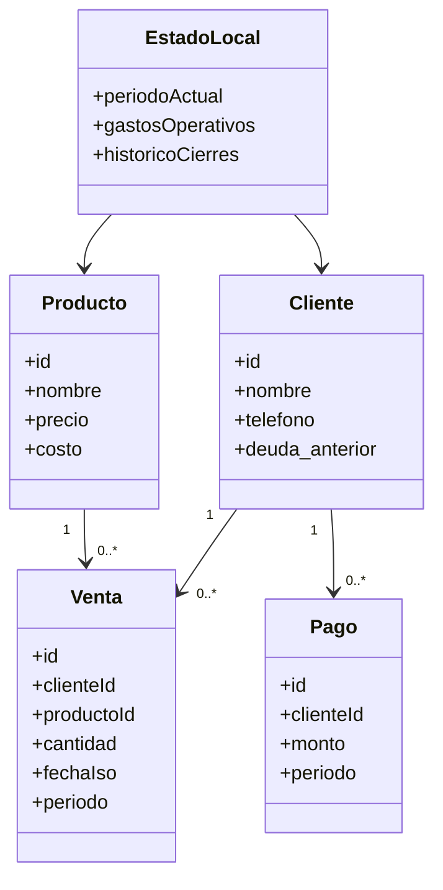
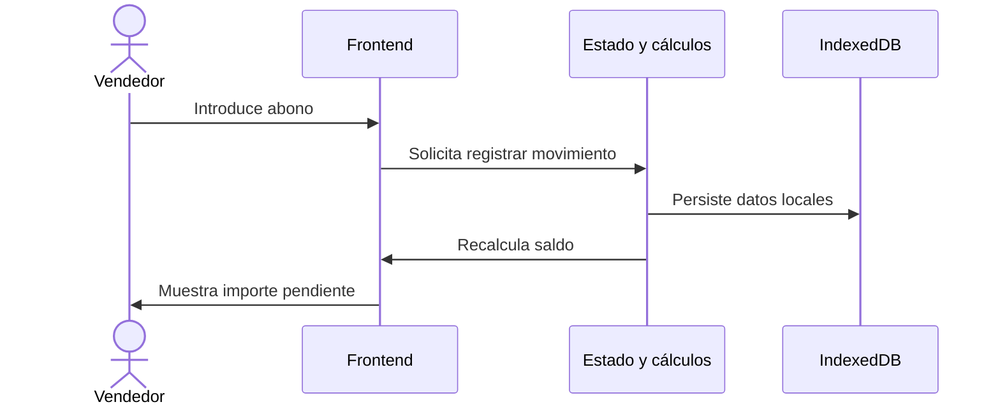
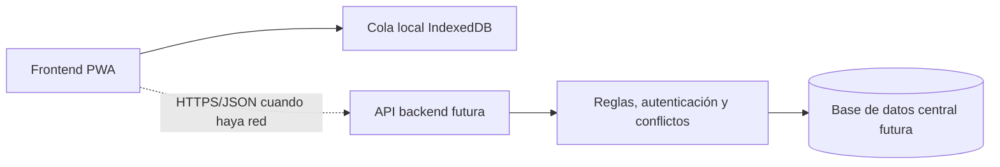

# Arquitectura y modelado UML

## 1. Arquitectura observada (2026-10-14)
Aplicación web estática: `index.html` y módulos JavaScript se ejecutan en el navegador. `app.js` gestiona vistas y eventos; `state.js` concentra estado y cálculos; `db.js` implementa el almacenamiento local IndexedDB. `sw.js` mantiene recursos en caché; no se encontró servicio backend ni base de datos remota en el repositorio.

## 2. Clases del dominio (modelo conceptual simplificado)
Este diagrama es **una representación técnica de los datos observados**, no un archivo UML generado automáticamente. El registro de gastos es agregado en el estado actual; el detalle por categoría se modela como evolución.

## 3. Secuencia propuesta para un abono local

## 4. Backend propuesto (aún no implementado)
El backend se responsabilizaría de las cuentas de usuario, autorizaciones, validación de movimientos, consistencia de saldos, auditoría, sincronización y copia central de seguridad. Se plantea una API REST sobre HTTPS con JSON y una base relacional (por ejemplo PostgreSQL).

**Protocolo futuro:** el navegador enviaría ventas, pagos y cambios mediante solicitudes HTTPS; el servidor devolvería confirmaciones, identificadores y datos actualizados. Hasta que se implemente este flujo, las banderas `_syncStatus` solo preparan el modelo para sincronización.

## 5. Herramientas de gestión
Git registra cambios y versiones; GitHub Issues gestiona incidencias, requisitos y riesgos; GitHub Projects organiza las tarjetas bajo el flujo Scrumban (Backlog, Por hacer, En progreso, En revisión, Finalizado).
